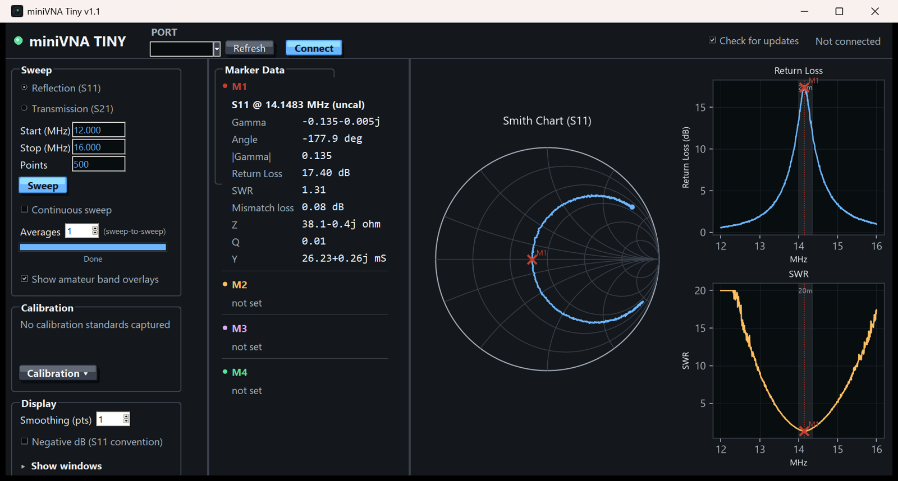

# miniVNA Tiny

An independent, open **replacement driver and control program for the mRS miniVNA Tiny** vector network analyser, written after the manufacturer stopped supporting the device. Connect, sweep, calibrate, mark and export from a single portable Windows program - no installer and no Python needed.

Site: https://lrizio.github.io/MiniVNATiny/ &nbsp;|&nbsp; Download: see [Releases](https://github.com/lrizio/MiniVNATiny/releases) (Windows, unzip and run)


*(simulated data)*

## What it does

* **Sweeps** in reflection (S11) or transmission (S21) mode, 1 MHz to 1.5 GHz, any start/stop/points; **Continuous sweep** for tuning a device live; sweep-to-sweep **averaging** and display **smoothing**.
* **Calibration**: 3-term Open/Short/Load for reflection and a thru (+ isolation) response calibration for transmission, with interpolation onto a different sweep grid. Save and load calibration files.
* **Plots**: Smith chart, return loss, SWR, S21 magnitude and phase, selectable and resizable, manual axis scales, amateur-band overlays, optional negative-dB (S11) convention.
* **Four markers** with a full readout: gamma, return loss, SWR, mismatch loss, Z, Q, Y, S21 dB/phase and group delay.
* **TDR**: distance-to-fault from a reflection sweep with velocity factor, window selection and a one-click wide-band sweep for short cables.
* **Export** Touchstone `.s1p` and CSV.
* **Portable**: settings, calibration, and window size and position are kept in `settings.json` next to the program, so the folder can live on a USB stick.
* **Optional update check**: one small request to GitHub for the latest release; switch it off with the tick box in the top bar.

## Run from source

```
pip install pyserial numpy matplotlib
python gui_app.py
```

The command-line scripts (`test_sweep.py`, `save_sweep.py`, `cal_report.py`, ...) use the same driver, `minivna_tiny.py`; edit the `PORT` constant in them to match your COM port. The calibration maths (`osl_calibration.py`, `thru_calibration.py`), `tdr.py` and `group_delay.py` each have a self-check you can run directly.

To build the exe, use PyInstaller with the Python that has the dependencies installed (`--onefile --windowed --icon icon.ico gui_app.py`, excluding unused heavy packages such as scipy and pandas if they are installed), and keep `icon.ico` beside the exe. `python scripts/make_user_guide.py` (needs `reportlab`) regenerates the User Guide PDF, which also ships in the release zip.

## Protocol

921600 baud 8N1, ASCII commands terminated by CR. The protocol was recovered by decompiling the GPL-licensed vna/J driver with a small classfile parser (`reference/classparse.py`) and cross-checking it against an independent Python implementation and the real hardware.

## Accuracy and safety

Measurements are only as good as your calibration; see [DISCLAIMER.md](DISCLAIMER.md). Licence: [MIT](LICENSE).

73 de VK3EI
